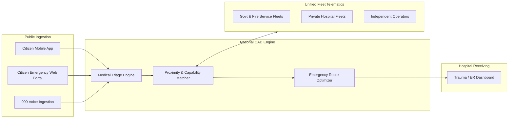
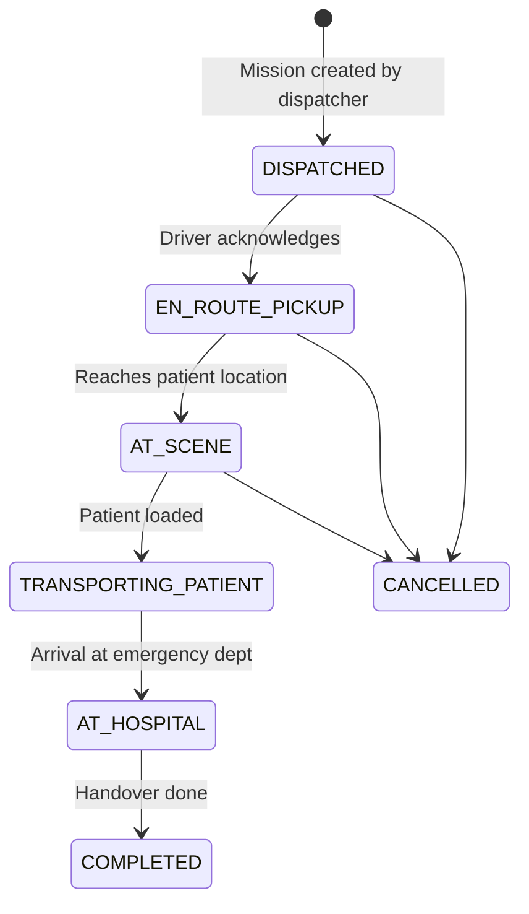

# Computer-Aided Dispatch (CAD) & Citizen Platform

> **FUTURE / CONCEPT ONLY.** Nothing in this document is built, agreed with any authority, or field-tested. Signal control requires prerequisites in [roadmap.md](../roadmap.md). Numbers and timings here are unsourced estimates unless cited; timing parameters conflict across docs and must be set by a licensed traffic engineer. Current mission states are in [dispatch-and-citizen-platform.md](this file) section 4 (below). The mission state machine in section 4 is the one part that is built (backend only).

## 1. The Fragmentation Problem in Bangladesh

Today, ambulance dispatch in Bangladesh is decentralized and inefficient:
* **Informal Syndicates:** Commercial ambulances park outside major public hospitals (DMCH, BSMMU, Suhrawardy) with no standardized pricing, often engaging in exploitative fare negotiation during critical emergencies.
* **Lack of Visibility:** Citizens in distress call individual hospital hotlines or local brokers without knowing which ambulance is geographically closest or appropriately equipped (e.g., ICU vs. basic oxygen).
* **Delayed Response:** Even when 999 is dialed, operators often have to make manual phone calls to regional fire stations or hospital lines to locate an available vehicle.

**Ambulance-AID-BD** introduces a unified, digital **National CAD & Citizen Dispatch Engine**.

---

## 2. Platform Architecture

---

## 3. Vehicle Classification Standards

Every registered ambulance is certified under one of five tiers per a five-tier scheme attributed to DGHS (Directorate General of Health Services). UNVERIFIED: no citation has been checked; treat the tiers as a working classification:

1. **Tier 1: Basic Life Support (BLS)**
   * Stretcher, portable oxygen cylinder, basic first-aid kit, automated external defibrillator (AED).
2. **Tier 2: Advanced Life Support (ALS)**
   * BLS features + multi-parameter patient monitor (ECG, SpO2, NIBP), intravenous infusion equipment, emergency pharmacology box, trained paramedic onboard.
3. **Tier 3: Intensive Care Unit (ICU) Ambulance**
   * ALS features + transport ventilator, syringe pumps, suction unit, cardiac defibrillator with pacing, emergency doctor onboard.
4. **Tier 4: Neonatal Intensive Care (NICU) Ambulance**
   * Infant transport incubator, specialized micro-ventilator, neonatal phototherapy lamp, pediatric emergency specialist.
5. **Tier 5: Mortuary / Freezer Van**
   * Refrigerated storage for deceased transport (non-emergency; not granted traffic preemption rights).

---

## 4. Emergency Mission State Machine

**Single source of truth: `backend/app/state_machine.py`.** All other docs defer to this list.

Mission states: `DISPATCHED`, `EN_ROUTE_PICKUP`, `AT_SCENE`, `TRANSPORTING_PATIENT`, `AT_HOSPITAL`, `COMPLETED`, `CANCELLED`. `COMPLETED` and `CANCELLED` are terminal. Created missions start in `DISPATCHED`. CANCELLED rules and the initial state are developer choices pending confirmation with a real dispatcher. Only the dispatcher creates or cancels; only the assigned driver advances.

**Vehicle availability is separate from mission state (FUTURE, not built).** The earlier diagram mixed in vehicle states `AVAILABLE` and `DECONTAMINATION` (restock/clean after handover). These belong to a future vehicle-status model, not the mission state list.

**Old names mapped (other docs used these):**

| Old name | Current |
| :--- | :--- |
| `DISPATCHED_TO_PATIENT` | `DISPATCHED` or `EN_ROUTE_PICKUP` |
| `PATIENT_ONBOARD` | `TRANSPORTING_PATIENT` |
| `MISSION_COMPLETED` | `COMPLETED` |
| `AVAILABLE`, `DECONTAMINATION` | vehicle states, not mission states |

* **Preemption eligibility (FUTURE, no preemption code exists):** if EVP is ever built, privileges would be limited to `EN_ROUTE_PICKUP` and `TRANSPORTING_PATIENT`, and ignored in all other states.

---

## 5. Citizen & 999 Interfaces

### 5.1 The Citizen Application
* **"One-Touch Emergency":**
  * Automatically detects user GPS coordinates.
  * Rapid triage questionnaire (e.g., Cardiac, Road Accident, Maternal, Respiratory, Pediatric).
  * Instant cost estimate governed by fare tables (UNVERIFIED: no regulated fare table is known to exist; pricing UNKNOWN).
* **Live Telemetry & Tracking:**
  * Shows real-time position of the assigned vehicle on an interactive map.
  * Direct VoIP call with the paramedic/driver.

### 5.2 The 999 CAD Operator Dashboard
* Integrated into the National Emergency Service 999 call centers:
  * Automatic Number Identification (ANI) / Location Identification (ALI).
  * "Auto-Recommend Nearest Unit" button based on real-time driving ETA (taking current traffic congestion and green corridors into account).
  * Direct push dispatch to the in-vehicle driver tablet.

### 5.3 Hospital Trauma Center Dashboard
* Informs destination emergency rooms before the patient arrives:
  * Live countdown timer to arrival.
  * Patient condition, vitals stream (if connected to ALS/ICU telemetry), and demographic data.
  * Eliminates delay at the hospital gate and allows blood bank and surgical teams to prepare.
