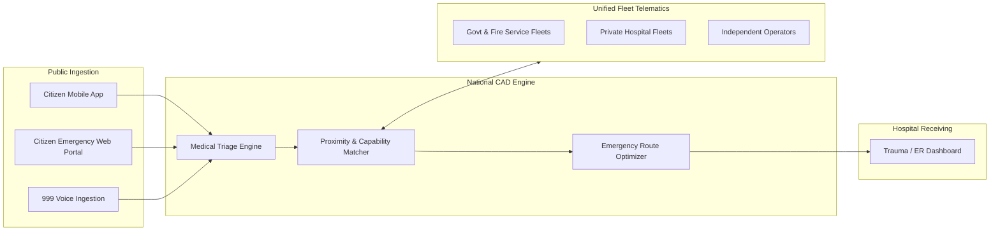
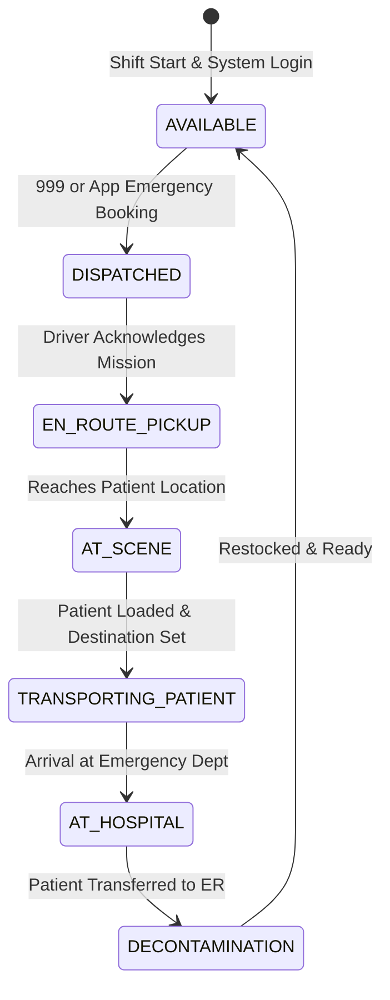

# Computer-Aided Dispatch (CAD) & Citizen Platform

## 1. The Fragmentation Problem in Bangladesh

Today, ambulance dispatch in Bangladesh is decentralized and inefficient:
* **Informal Syndicates:** Commercial ambulances park outside major public hospitals (DMCH, BSMMU, Suhrawardy) with no standardized pricing, often engaging in exploitative fare negotiation during critical emergencies.
* **Lack of Visibility:** Citizens in distress call individual hospital hotlines or local brokers without knowing which ambulance is geographically closest or appropriately equipped (e.g., ICU vs. basic oxygen).
* **Delayed Response:** Even when 999 is dialed, operators often have to make manual phone calls to regional fire stations or hospital lines to locate an available vehicle.

**Ambulance-AID-BD** introduces a unified, digital **National CAD & Citizen Dispatch Engine**.

---

## 2. Platform Architecture

---

## 3. Vehicle Classification Standards

Every registered ambulance is certified under one of five tiers according to DGHS (Directorate General of Health Services) standards:

1. **Tier 1: Basic Life Support (BLS)**
   * Stretcher, portable oxygen cylinder, basic first-aid kit, automated external defibrillator (AED).
2. **Tier 2: Advanced Life Support (ALS)**
   * BLS features + multi-parameter patient monitor (ECG, SpO2, NIBP), intravenous infusion equipment, emergency pharmacology box, trained paramedic onboard.
3. **Tier 3: Intensive Care Unit (ICU) Ambulance**
   * ALS features + transport ventilator, syringe pumps, suction unit, cardiac defibrillator with pacing, emergency doctor onboard.
4. **Tier 4: Neonatal Intensive Care (NICU) Ambulance**
   * Infant transport incubator, specialized micro-ventilator, neonatal phototherapy lamp, pediatric emergency specialist.
5. **Tier 5: Mortuary / Freezer Van**
   * Refrigerated storage for deceased transport (non-emergency; not granted traffic preemption rights).

---

## 4. Emergency Mission State Machine

To balance rapid dispatch with anti-abuse security, each ambulance operates on a strict finite state machine:

* **Preemption Activation:**
  * Signal preemption privileges are **strictly locked** to `EN_ROUTE_PICKUP` and `TRANSPORTING_PATIENT` states.
  * In `AVAILABLE`, `AT_SCENE`, `DECONTAMINATION`, or off-duty states, preemption requests are ignored by the Traffic Management Center.

---

## 5. Citizen & 999 Interfaces

### 5.1 The Citizen Application
* **"One-Touch Emergency":**
  * Automatically detects user GPS coordinates.
  * Rapid triage questionnaire (e.g., Cardiac, Road Accident, Maternal, Respiratory, Pediatric).
  * Instant cost estimate governed by municipal regulated fare tables (distance-based or fixed tier).
* **Live Telemetry & Tracking:**
  * Shows real-time position of the assigned vehicle on an interactive map.
  * Direct VoIP call with the paramedic/driver.

### 5.2 The 999 CAD Operator Dashboard
* Integrated into the National Emergency Service 999 call centers:
  * Automatic Number Identification (ANI) / Location Identification (ALI).
  * "Auto-Recommend Nearest Unit" button based on real-time driving ETA (taking current traffic congestion and green corridors into account).
  * Direct push dispatch to the in-vehicle driver tablet.

### 5.3 Hospital Trauma Center Dashboard
* Informs destination emergency rooms before the patient arrives:
  * Live countdown timer to arrival.
  * Patient condition, vitals stream (if connected to ALS/ICU telemetry), and demographic data.
  * Eliminates delay at the hospital gate and allows blood bank and surgical teams to prepare.
