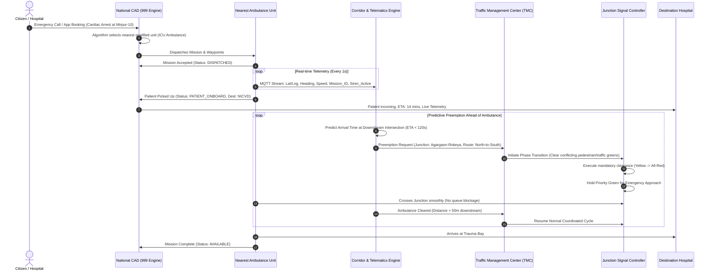

# System Overview & Architecture

## 1. Vision & Purpose

**Ambulance-AID-BD** connects three historically isolated components of urban infrastructure in Bangladesh:
1. **Emergency Medical Services (EMS) Fleets** (Ambulances).
2. **Municipal Traffic Signals** (Intelligent Transportation Systems / Traffic Management Centers).
3. **Emergency Dispatch & Citizen Platforms** (National 999 CAD and public booking interfaces).

By synchronizing real-time telematics with digital traffic controllers, the platform creates an automated **"Green Corridor"** for emergency vehicles while providing complete visibility of available life-saving ambulances nationwide.

---

## 2. End-to-End Data Flow

---

## 3. Subsystem Breakdown

### 3.1 Fleet Telematics & In-Vehicle Unit (IVU)
* **Hardware Unit:** Automotive-grade OBD-II / CAN-bus connected cellular IoT gateway with high-precision GNSS (GPS + BeiDou + GLONASS, 10 Hz refresh rate).
* **Sensors:**
  * Siren & Beacon current sensors (to verify if emergency sirens are physically engaged).
  * Accelerometer & Gyroscope (detecting collision or reckless operation).
  * Optional patient vitals bridge (Bluetooth/Wi-Fi connection to portable defibrillators/monitors).
* **Driver Terminal:** A ruggedized in-cabin Android tablet running the **CAD Driver Application**:
  * Displays turn-by-turn navigation optimized for emergency green corridors.
  * One-touch mission status toggles: `En Route to Scene`, `At Scene`, `Transporting Patient`, `At Hospital`, `Clear / Available`.

### 3.2 Cloud Orchestration & Corridor Engine
* **Ingestion Gateway:** High-throughput MQTT brokers (EMQX or VerneMQ) terminating TLS connections with mutual authentication (mTLS).
* **Geospatial & Prediction Core:**
  * Built on top of PostGIS, Redis (geospatial indexing via `GEOSEARCH`), and an open routing engine (OSRM or Valhalla).
  * Calculates dead-reckoning and ETA projections to every upcoming traffic signal within a 3 km radius.
* **Corridor Flushing Logic:**
  * When an ambulance is 2–4 minutes away from a junction, the engine sends an early preemption signal to "flush" the queue of stopped vehicles ahead of the emergency vehicle.

### 3.3 Traffic Management Center (TMC) Integration
* **Protocol Adapters:** Supports modern traffic signal communication standards:
  * **NTCIP 1202 v03** (National Transportation Communications for ITS Protocol - Object Definitions for Actuated Traffic Signal Controller Units).
  * **SCATS (Sydney Coordinated Adaptive Traffic System) / SCOOT** integration APIs.
  * **Custom REST/WebSocket/MQTT edge connectors** for proprietary or industrial PLC controllers deployed by local city corporations.
* **Failsafe Mechanisms:**
  * Preemption commands have strict lease times (maximum hold of 60–90 seconds) with automatic timeout rollback.
  * Minimum safety clearance: yellow time ($\ge 3$s), all-red interval ($\ge 2$s), and pedestrian clearance timers are mathematically locked in hardware to prevent instant switching.

### 3.4 National Computer-Aided Dispatch (CAD) & Citizen App
* **Operator Console:** Web-based operational dashboard for 999 emergency call-takers and dispatchers:
  * Real-time geospatial overview of every active ambulance in Bangladesh.
  * Filterable by vehicle capability: BLS, ALS, ICU, Cardiac, Neonatal (NICU), Freezer van.
  * Triage-based automatic unit recommendation.
* **Citizen Mobile & Web App:**
  * Emergency booking for families and bystanders: enter location and medical urgency.
  * Transparent pricing and real-time GPS tracking of the dispatched unit.
  * Direct telemetry link to hospital emergency admission desks.

---

## 4. Key Performance Indicators (KPIs)

| Metric | Current Baseline (Dhaka Urban) | Ambulance-AID-BD Target |
| :--- | :--- | :--- |
| **Average Response Time (Dispatch to Scene)** | 35 – 55 minutes | $\le 15$ minutes |
| **Hospital Transit Time during Peak Hours** | 45 – 80 minutes | $\le 20$ minutes |
| **Intersection Wait Time (At Signals)** | 3 – 12 minutes per major junction | $\le 15$ seconds |
| **Siren Misuse / Unverified Runs** | Estimated 30 – 50% | $< 1\%$ (Cryptographically audited) |
| **Citizen Discovery of Nearest Unit** | 10 – 25 minutes of calling brokers/hospitals | $< 60$ seconds via App / 999 |
