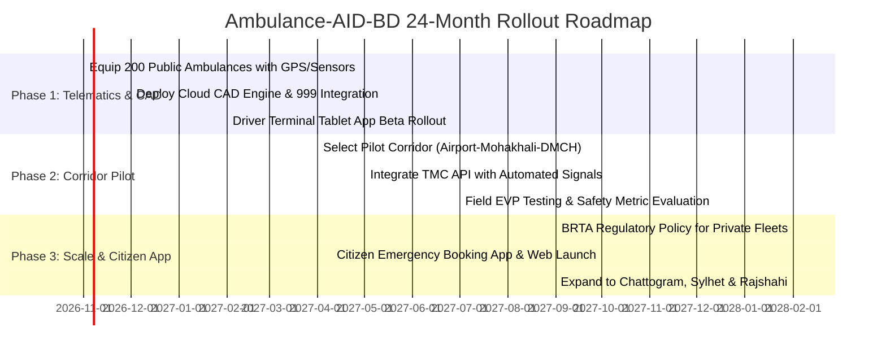

# Implementation Roadmap for Bangladesh

A successful rollout of **Ambulance-AID-BD** requires a phased approach that starts with high-impact software telematics and controlled corridor pilots before scaling to national municipal infrastructure.

---

---

## Phase 1: Fleet Telematics & Centralized CAD (Months 1 – 6)

### Objective
Establish total digital visibility of government and major hospital emergency fleets without modifying physical traffic signals yet.

### Deliverables
1. **Hardware Outfitting:**
   * Install automotive-grade 4G IoT telematics units on **200 public emergency vehicles**:
     * Bangladesh Fire Service & Civil Defence ambulances.
     * Government tertiary hospital fleets (DMCH, BSMMU, NICVD, NITOR, Suhrawardy).
     * Anjuman Mufidul Islam charitable ambulances.
   * Wire current sensors to emergency siren/lightbar switches.
2. **Software Platform:**
   * Deploy the centralized CAD ingestion gateway and spatial database.
   * Roll out the **Driver Terminal Application** on ruggedized dashboard tablets.
   * Provide a web-based dispatch console for the **National Emergency Service 999** operators.
3. **Data Collection:**
   * Benchmark baseline trip durations, typical junction wait times, and routing bottlenecks during morning and evening rush hours.

---

## Phase 2: Single-Corridor Dynamic Preemption Pilot (Months 7 – 12)

### Objective
Integrate the cloud engine with newly automated traffic signal controllers along a critical emergency medical artery in Dhaka to validate the Green Wave algorithm.

### Target Pilot Corridor
* **Corridor Selection:** **Mirpur Road ➔ Science Lab ➔ Shahbagh ➔ DMCH / BSMMU** (or alternatively **Airport Road ➔ Mohakhali ➔ Tejgaon**).
* Total Intersections: ~8–12 automated signal junctions.

### Deliverables
1. **Signal Controller Interface:**
   * Deploy secure edge gateway connectors linking the municipal Traffic Management Center (TMC) and the Corridor Engine.
   * Configure controller firmware to enforce fail-safe clearance intervals (minimum yellow and all-red buffers).
2. **Controlled Field Trials:**
   * Execute staged emergency runs under peak and off-peak traffic conditions.
   * Test anticipatory queue flushing (triggering preemption 2–3 minutes before arrival).
   * Evaluate cross-traffic delay impact to ensure preemption does not collapse surrounding street grids.
3. **Empirical Assessment:**
   * Target: $\ge 40\%$ reduction in emergency transit duration through the corridor.

---

## Phase 3: Public Citizen Platform & Nationwide Expansion (Months 13 – 24)

### Objective
Onboard private ambulance fleets, launch the public-facing booking portal, and scale to other major urban centers.

### Deliverables
1. **Public Emergency Portal & Mobile App:**
   * Launch native iOS, Android, and progressive web apps for citizens.
   * Real-time map displaying nearest available BLS, ALS, and ICU units with verified pricing.
   * 999 dispatch operator direct push-to-app workflow.
2. **Regulatory Mandate & Private Fleet Onboarding:**
   * Collaborate with the Ministry of Road Transport and Bridges (BRTA) and the Directorate General of Health Services (DGHS) to mandate telematics compliance for private ambulance operating licenses.
   * Onboard over 2,500 private, clinic, and NGO ambulances across Dhaka.
3. **Multi-City Rollout:**
   * Extend signal preemption and CAD infrastructure to Chattogram (Agrabad ➔ CMCH corridor), Sylhet, Rajshahi, and Khulna.
