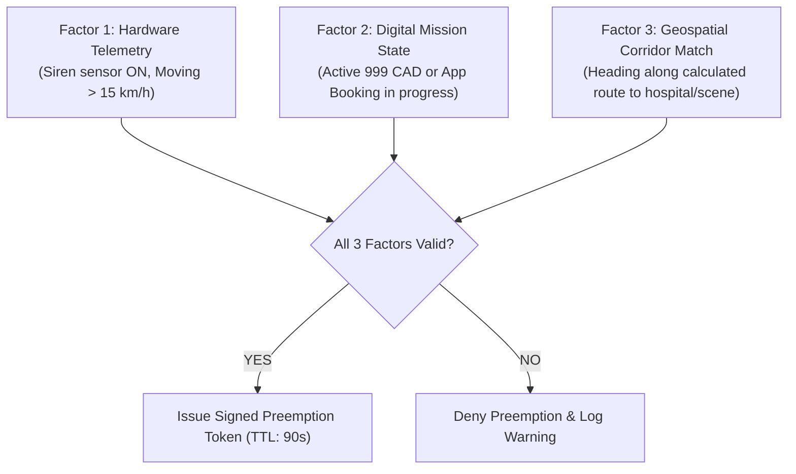

# Security, Cryptography & Anti-Abuse Architecture

Traffic signal preemption is a high-stakes municipal capability. A vulnerability could allow malicious actors to hijack city signals or enable unethical drivers to clear traffic for non-emergencies. This document details the cryptographic safeguards and anti-abuse mechanisms governing **Ambulance-AID-BD**.

---

## 1. Threat Modeling & Vulnerability Vectors

| Threat Vector | Description | Impact | Mitigation Strategy |
| :--- | :--- | :--- | :--- |
| **Siren Misuse (Empty Runs)** | Ambulance driver runs siren and activates green lights while empty or off-duty. | Unjustified traffic disruption, public distrust. | **Multi-factor Mission State Machine:** Hardware siren sensor + verified patient booking + hospital check-in verification. |
| **GPS Spoofing & Replay Attacks** | An adversary broadcasts fake vehicle telemetry to artificially hold signals green. | Gridlock on conflicting roads, safety hazard. | **mTLS & Ephemeral Signed Tokens:** Trackers sign packets with hardware-bound keys; Kalman filtering flags impossible speed jumps. |
| **API Compromise / Signal Hijacking** | Unauthorized entity sends preemption commands directly to the Traffic Management Center (TMC). | Catastrophic signal failure or physical crashes. | **mTLS with Ed25519 Signatures & Controller Watchdog Timers:** Microcontroller firmware rejects unsigned payloads and limits hold times to 90 seconds. |
| **Hardware Tampering** | Driver disconnects tracker, pulls out fuses, or bridges siren sensors. | Unmonitored vehicle operation. | **Tamper Detection Circuitry:** Tracker triggers immediate alert on power disconnect; unmonitored units lose preemption rights. |

---

## 2. Multi-Factor Anti-Abuse Verification

An ambulance does **not** get green lights simply because a driver flips an in-cabin switch. Preemption requires concurrent satisfaction of three independent factors:



### The Three Factors:
1. **Physical/Hardware Verification:**
   * A current transducer sensor wired to the ambulance emergency siren and lightbar circuit detects actual electrical engagement.
   * Accelerometers confirm the vehicle is actively in motion.
2. **Digital Mission Authorization:**
   * A valid mission ID must be actively registered in the CAD engine (generated either by a 999 emergency call-taker or a citizen emergency app request with verified phone OTP).
   * Status must be either `DISPATCHED_TO_PATIENT` or `PATIENT_ONBOARD`.
3. **Geospatial & Route Plausibility:**
   * The vehicle must be progressing along a logical corridor toward the declared pickup address or a recognized emergency hospital (DMCH, BSMMU, NICVD, etc.).
   * Deviating into residential detours or stopping at commercial locations immediately revokes the preemption token.

---

## 3. Cryptographic Token Architecture

Traffic signal controllers must verify that preemption commands originate from the authorized municipal corridor engine:

1. **Mutual TLS (mTLS):**
   * Every In-Vehicle Unit (IVU) carries a unique X.509 client certificate provisioned by the National Telematics Root CA.
   * Communications over MQTT use TLS 1.3 with client certificate validation.
2. **Signed Preemption Lease Tokens:**
   * The corridor engine generates a short-lived JSON Web Token (JWT) signed using an **Ed25519** private key.
   * Claims include:
     ```json
     {
       "iss": "bd-its-cad.gov.bd",
       "sub": "AMB-DHK-METRO-CH-71-4921",
       "junc": "DHK_MIRPUR_10_01",
       "phase": 2,
       "exp": 1791814620,
       "max_hold_sec": 90
     }
     ```
   * The edge signal controller verifies the token against the municipal public key locally before initiating any phase transition.

---

## 4. Audit Logging & Compliance Reporting

* **Immutable Log Ledger:**
  * Every preemption event is recorded with:
    * `timestamp_start` and `timestamp_released`.
    * `mission_id` and assigned patient case reference.
    * GPS breadcrumb trail during the entire preemption sequence.
    * Average speed through intersection.
* **Monthly Compliance Audits:**
  * Reports are automatically distributed to the Dhaka Metropolitan Police (DMP) Traffic Division and the Directorate General of Health Services (DGHS).
  * Vehicles flagged for frequent siren activation without valid patient bookings receive automated warnings, followed by revocation of preemption privileges and legal fines under the Road Transport Act.
